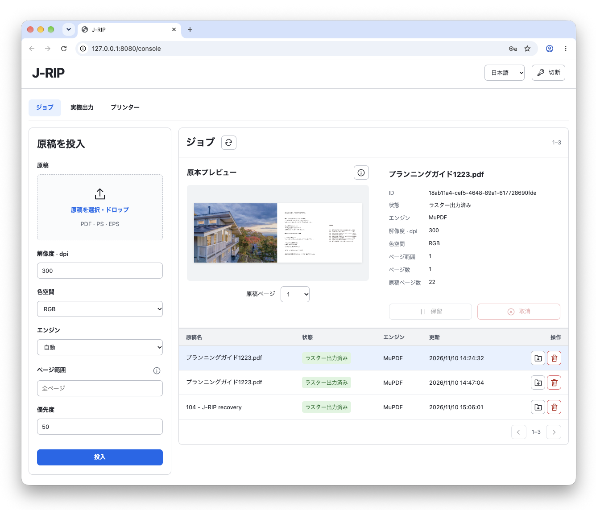
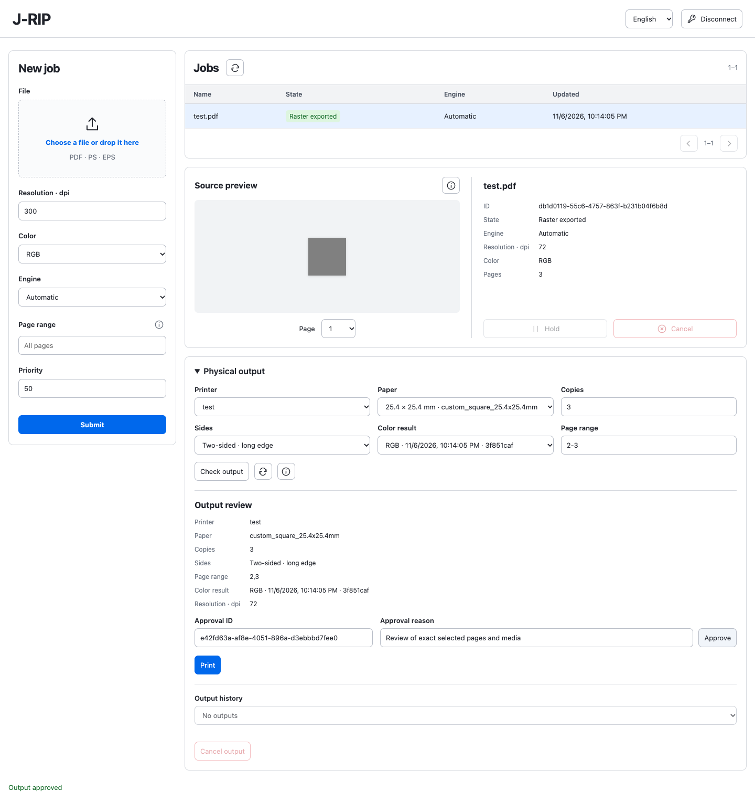
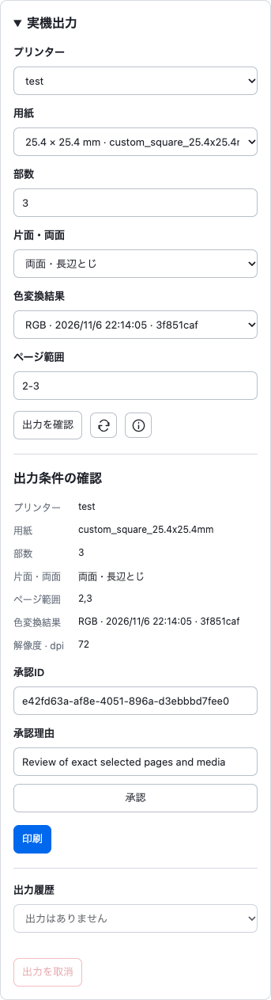
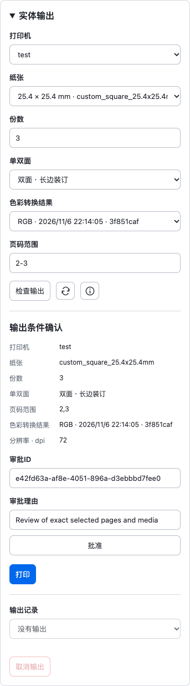

# RIP-Server / J-RIP



PDF・PostScript・EPSを受け取り、MuPDF／Ghostscriptで描画し、TIFF出力・ICC色変換・結果確認・承認付きプリンター配送まで扱う、ローカル／エッジ向けRIPサーバーです。操作画面は **`/console`**。SQLiteへジョブと証跡を保存します。

Local/edge RIP server: PDF/PS/EPS → isolated MuPDF/Ghostscript → TIFF → explicit ICC processing → reviewed/approved printer delivery. Jobs and evidence persist in SQLite; the operator console supports English, Japanese and Simplified Chinese.

本地／边缘RIP服务器：PDF／PS／EPS → 隔离MuPDF／Ghostscript → TIFF → 显式ICC处理 → 确认及审批后投递打印机。SQLite持久保存作业与证据，操作界面支持英日中三语。

実装範囲と実機検証待ちは [ROADMAP](docs/ROADMAP.md)、詳細な運用は [Local runtime / 一括起動 / 统一启动](docs/LOCAL-RUNTIME.md) を参照してください。実機・OSドライバーの互換性を未検証のまま完了扱いにはしていません。

See the roadmap for exact implementation and acceptance boundaries. Physical printers and OS drivers still require environment-specific acceptance. / 具体实现与验收范围见路线图，实体设备及OS驱动仍需对应环境验收。

## 起動 / Start / 启动

macOSまたはLinux、Rust（rustup）、稼働中のDockerが必要です。buildスクリプトはHomebrew版cargoの有無にかかわらず、rustup経由で指定版を使います。Rustの版は `rust-toolchain.toml` に固定しています。Python 3は受入テストで使用します。

Build scripts explicitly use the rustup toolchain from rust-toolchain.toml, including when Homebrew cargo is also installed. Requires macOS/Linux, rustup and a running Docker daemon. Python 3 is used by acceptance tests. / 构建脚本通过rustup使用固定版本，即使同时安装Homebrew cargo。需要macOS／Linux、rustup及运行中的Docker；验收测试使用Python 3。

```sh
# Keep the same secret for subsequent restarts / 再起動時も同じ秘密値を使う / 重启时保持相同密钥
export JRIP_API_TOKEN="$(openssl rand -hex 32)"
export JRIP_DATA_ROOT="$PWD/data"

# Build all services and the three sandbox images / 全サービス・3イメージを構築 / 构建全部服务与三个镜像
bash scripts/build-rip-server.sh

# Validate configuration, ports, binaries and Docker without starting services
# 設定・ポート・実行ファイル・Dockerを事前診断 / 预检配置、端口、程序与Docker
bash scripts/start-rip-server.sh --check

# Foreground managed stack / フォアグラウンドで一括起動 / 前台统一启动
bash scripts/start-rip-server.sh
```

- 操作画面 / Console / 操作界面：<http://127.0.0.1:8080/console>
- API：`http://127.0.0.1:8080`（`JRIP_LISTEN`）
- PDF受付用IPP / PDF proof IPP / PDF接收IPP：`ipp://127.0.0.1:8631/ipp/print`（`JRIP_IPP_LISTEN`）
- 成果物 / Artifacts / 成果物：`data/jobs/<job-id>/raster/page-000001.tiff` 以降
- ログ / Logs / 日志：`data/logs/jrip-*.log`

**原稿を投入するとdispatcherがworkerを自動起動します。ジョブごとの手動worker起動は不要です。** API、IPP、RIP dispatcher、ICC worker、PDF検査workerをまとめて監視し、どれかが終了したら残りも停止します。Ctrl+CまたはSIGTERMで停止し、workerの処理中passを待ちます。再起動時は同じデータroot・認可設定を使ってください。データrootは専用ユーザーだけがアクセスできる場所に配置します。IPPが不要なら `--without-ipp` を追加できます。

Submitted jobs are dispatched automatically. The supervisor manages API, IPP, RIP, color and inspection services; a child exit stops the stack. Ctrl+C/SIGTERM drains active work. Reuse the same root and credentials on restart, in a directory private to the service user. Add `--without-ipp` for REST-only operation.

提交后自动调度worker，无需逐作业手动启动。统一监督API、IPP、RIP、色彩及检查服务；子进程退出时停止整个栈。Ctrl+C／SIGTERM等待当前处理结束。重启使用相同目录及凭据，并将数据目录设为服务用户私有；仅需REST时添加 `--without-ipp`。

既定モードはファイル出力です。**実機送信workerは起動しません。** IPPの `COMPLETED` もTIFF出力完了を表し、紙への印刷完了ではありません。

Default mode exports files and never starts physical dispatch. IPP completion means TIFF export, not printed paper. / 默认模式只输出文件，不启动实体投递；IPP完成表示TIFF导出，不代表纸张打印完成。

## 実機への出力 / Physical output / 实体输出

プリンターと主体別tokenを設定してから、実機モードを明示します。設定例内のURI・用紙・tokenを実際の値へ変更してください。UIへは認可ファイル内の管理者／操作主体のtokenで接続します。

Configure destinations and identity credentials before explicitly enabling physical mode. Replace example URI/media/tokens and connect with a configured credential. / 先配置目标与主体凭据，再明确启用实体模式；替换示例URI、纸张和token，使用配置内凭据连接。

```sh
cp config/printers.example.json config/printers.local.json
cp config/auth-policy.example.json config/auth-policy.local.json
# Edit both files / 両ファイルを編集 / 编辑两个文件
export JRIP_PRINTER_CONFIG="$PWD/config/printers.local.json"
export JRIP_AUTH_POLICY="$PWD/config/auth-policy.local.json"
bash scripts/start-rip-server.sh --with-printers --check
bash scripts/start-rip-server.sh --with-printers
```

実機モードはpipeline・delivery・機器観測workerも起動します。一括起動では印刷承認を既定で必須にします（`JRIP_REQUIRE_PRINT_APPROVAL=1`）。明示的に `0` を設定した場合だけこの既定を変更します。承認は投入条件に拘束され、起動時点ですでに投入済みの配送の取消にはなりません。実機モードを起動すると、保存済みの配送キューも再開します。結果不明の `UNKNOWN` は自動再送しません。

Physical mode also starts pipeline, delivery and observation workers. Managed startup defaults to required print approval; only an explicit `JRIP_REQUIRE_PRINT_APPROVAL=0` overrides it. Existing admitted deliveries resume when physical mode starts; approval policy does not retroactively cancel them. UNKNOWN outcomes are never automatically resent.

实体模式同时启动流程、投递及观察worker。统一启动默认要求打印审批，只有明确设置 `JRIP_REQUIRE_PRINT_APPROVAL=0` 才覆盖。启动实体模式会恢复已接收的投递队列，审批策略不会追溯取消它们。UNKNOWN结果不会自动重发。

操作画面では生成済み原稿を選び、「実機出力」で出力先・用紙・部数・両面・ページ範囲・色変換結果を指定し、確認→必要な承認→印刷へ進みます。拡大縮小や未対応能力への暗黙変更は行いません。独立したプリンターパネルは原稿未選択でも使え、保存状態をSSEで自動更新します。

Select an exported job to review media/copies/duplex/pages/color, approve if required, then print explicitly. No implicit scaling or substitution. The independent printer panel works without a document and follows saved reports via SSE.

选择已导出作业，确认目标、纸张、份数、双面、页码及色彩结果，按需审批后明确打印；不隐式缩放或替换。独立打印机面板无需选择原稿，通过SSE自动更新保存报告。

## 基本API / Basic API / 基础API

```sh
curl -H "Authorization: Bearer $JRIP_API_TOKEN" \
  -F 'manifest={"name":"proof.pdf","format":"application/pdf","dpi":300,"color_mode":"rgb","engine":"auto"};type=application/json' \
  -F 'document=@sample.pdf;type=application/pdf' \
  http://127.0.0.1:8080/api/v1/jobs
```

| 操作 / Operation / 操作 | Endpoint |
|---|---|
| ヘルスチェック / API liveness / API存活 | `GET /health` |
| 投入・一覧 / Submit/list / 提交与列表 | `POST/GET /api/v1/jobs` |
| 状態・revision / Job state / 作业状态 | `GET /api/v1/jobs/{id}` |
| 成果物 / Artifacts / 成果物 | `GET /api/v1/jobs/{id}/artifacts` |
| ダウンロード / Download / 下载 | `GET /api/v1/jobs/{id}/artifacts/{name}` |
| プレビュー / Preview / 预览 | `GET /api/v1/jobs/{id}/artifacts/{name}/preview` |
| 設定済み機器 / Destinations / 已配置设备 | `GET /api/v1/printers` |
| 保存状態の通知 / Stored-state SSE / 保存状态通知 | `GET /api/v1/printers/{id}/observations/stream` |

原稿上限32 MiB、DPI 72〜2400、色はRGB／CMYK／Gray。PDFは既定MuPDF、PS／EPSはGhostscript、PDFのGhostscript明示指定も可能です。失敗時にエンジンを暗黙変更しません。workerは原稿hash・構造・サイズ・フォント情報を検査してから描画し、公開前にTIFFを検証します。成果物の取得も登録サイズ・SHA-256を再確認します。

Inputs are bounded to 32 MiB and 72–2400 dpi. PDF defaults to MuPDF; PS/EPS use Ghostscript, which may also be explicitly selected for PDF. No silent fallback. Workers validate source identity/structure/geometry/fonts and verify TIFFs before publication; downloads recheck size/hash.

输入最大32 MiB、72–2400 dpi。PDF默认MuPDF，PS／EPS使用Ghostscript，PDF也可明确选择Ghostscript；不静默回退。worker检查原稿标识、结构、尺寸及字体，发布前验证TIFF，下载再次验证大小及hash。

## 検証 / Validation / 验证

```sh
cargo fmt --all -- --check
cargo clippy --workspace --all-targets --locked -- -D warnings
cargo test --workspace --locked

# Managed-stack acceptance after building images/binaries (Python 3 required)
# ビルド済み環境で全工程を受入検証 / 在已构建环境验收完整流程
cargo test -p jrip-server --test runtime managed_stack --locked -- --ignored --nocapture
```

受入テストは私有の一時ディレクトリとlocalhost模擬プリンターだけを使います。API／IPPからの自動RIP、PDF／PS／EPS、TIFF hash・プレビュー、不正原稿後の処理継続、ICC・承認・模擬機器完了、停止／再起動・完了済み配送の再送防止を確認します。利用者のデータや実機設定は使用しません。

Acceptance uses only private temporary data and a localhost fake printer: automatic API/IPP rendering, formats, hashes/preview, rejected-source recovery, ICC/approval/delivery and restart/no-resend. User data and physical printer configuration are not used.

验收仅使用私有临时数据与localhost模拟设备，验证API／IPP自动RIP、格式、hash／预览、不正确原稿后继续处理、ICC／审批／投递、重启及防重发；不使用用户数据或实体设备配置。

## 範囲と運用資料 / Scope and guides / 范围及指南

| 状態 / Status / 状态 | 内容 / Scope / 内容 |
|---|---|
| 🟢 [Done] | 自動RIP・TIFF・ICC・操作画面・キュー・承認・Native IPP配送・MCP／ACX基盤 / Automatic RIP, color, console, queue, approval and Native IPP delivery / 自动RIP、色彩、界面、队列、审批及Native IPP投递 |
| ⭕️ [Pending] | 実プリンターの品質・両面・取消・障害復旧、Mac／Windowsドライバー受入 / Physical device and driver acceptance / 实体设备及驱动验收 |
| 🔴 [Later] | 特色・DeviceN・Trapping・ハーフトーン・CMYK16等 / Advanced press features / 特色、DeviceN、补漏白、网点及CMYK16等 |

PDFだけのIPP受付をAirPrint／IPP Everywhere適合とは呼びません。LAN公開はTLS終端・認可を含めて配備し、IPPのLAN受付は明示許可が必要です。Windowsの一括起動・共有NFS・クラウド構成は別の受入範囲です。

PDF-only IPP is not an AirPrint/IPP Everywhere conformance claim. LAN deployment needs transport/authentication configuration and explicit IPP opt-in. Windows managed startup, shared NFS and cloud deployment remain separate acceptance work.

仅PDF的IPP接收不代表AirPrint／IPP Everywhere符合性。LAN部署须配置传输保护与授权，并明确允许IPP接收。Windows统一启动、共享NFS及云部署属于独立验收范围。

- [Local runtime / 一括起動 / 统一启动](docs/LOCAL-RUNTIME.md)
- [Operator console / 操作画面 / 操作界面](docs/OPERATOR-CONSOLE.md)
- [IPP proof printer / PDF仮想プリンター / PDF虚拟打印机](docs/IPP-PROOF.md)
- [ICC processing / 色管理 / 色彩管理](docs/COLOR-MANAGEMENT.md) · [Color Policies](docs/COLOR-POLICIES.md)
- [Pipeline / 処理連携 / 流程](docs/PIPELINE.md) · [Delivery / 配送 / 投递](docs/DELIVERY.md)
- [Authentication and approvals / 認可と承認 / 授权及审批](docs/AGENT-CONTROL.md)
- [Printer subscriptions / 機器状態購読 / 设备状态订阅](docs/CONSOLE-PRINTER-SUBSCRIPTIONS.md)
- [MCP](docs/MCP-HTTP.md) · [ACX lifecycle](docs/ACX-LIFECYCLE.md)
- [Retention / 保持期限 / 保留期限](docs/ARTIFACT-RETENTION.md) · [Maintenance / 清掃 / 清理](docs/MAINTENANCE.md)
- [Development specification / 開発仕様 / 开发规格](docs/RIP-Server開発仕様書.md) · [ROADMAP](docs/ROADMAP.md)

## スクリーンショット / Screenshots / 截图

実ブラウザー・検証原稿・模擬プリンターによる操作画面です。 / Real-browser test captures with owned documents and a fake printer. / 使用测试原稿与模拟设备的真实浏览器截图。



<details><summary>モバイル / Mobile / 移动端</summary>
<p> </p>
</details>
